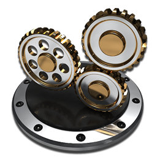
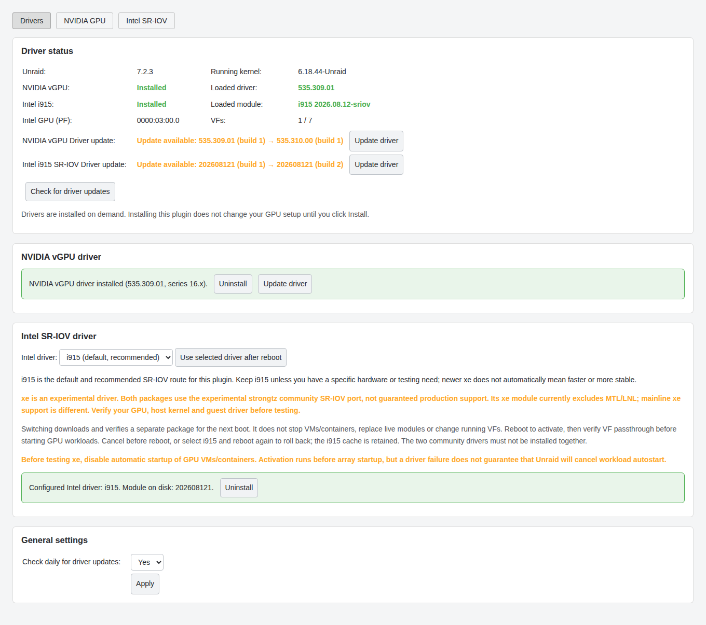

# my-unraid-vgpu-manager

Manage NVIDIA vGPU and Intel SR-IOV on Unraid: download matching drivers, assign virtual GPUs to VMs, and restore them after reboot.

[English](README.md) · [简体中文](README.zh-CN.md) · [User guide](docs/guide.md)

[](https://github.com/hellomrli/my-unraid-vgpu-manager/actions/workflows/check.yml)
[](LICENSE)

## Install the plugin

**[Plugin installation link (.plg)](https://github.com/hellomrli/my-unraid-vgpu-manager/raw/master/my-unraid-vgpu-manager.plg)**

Open **Plugins → Install Plugin** in Unraid and paste this URL. Use the **copy button** at the top right of the code block:

```text
https://github.com/hellomrli/my-unraid-vgpu-manager/raw/master/my-unraid-vgpu-manager.plg
```

Requires **Unraid 7.2.3 or newer** and a compatible GPU. Unraid downloads the matching plugin package through this `.plg`; future updates use the same plugin manager. **No plugin GitHub Release or manual package download is needed.** Installing the plugin does not install a GPU driver.

> [!IMPORTANT]
> **Intel SR-IOV defaults to i915, the recommended choice. xe is an optional experimental driver; switching requires a reboot.** Plugin updates never silently switch you to xe.

## Quick start

Open **Settings → Unraid vGPU Manager**. Before installing a driver, remove other plugins managing the same driver stack and reboot; monitoring-only plugins such as intel-gpu-top are not conflicts.

| Your GPU | First steps |
|---|---|
| Intel with SR-IOV support | In **Drivers**, keep **i915 (recommended)** and install. Follow the Intel tab's IOMMU/boot guidance and reboot when requested. Set the VF count, then pass a **VF**, never the PF, through to a VM. |
| NVIDIA with vGPU support | In **Drivers**, select the supported series and install. In **NVIDIA GPU**, configure licensing, create a vGPU from a profile and bind it to a VM. Cold-start the VM to attach it. |

Expected result: the selected driver and virtual GPU devices appear on the page, and enabled devices are restored from verified cached packages at boot. Guest operating systems still need compatible GPU drivers.



*Interface preview from the isolated test environment, not a claim of hardware certification.*

## Choosing i915 or xe

| Driver | Recommendation |
|---|---|
| **i915** | **Default and recommended.** Keeps the project's existing Intel SR-IOV path. An upstream xe update is not a reason to switch a working installation. |
| **xe** | **Experimental, opt-in.** A newer Intel driver architecture, provided as a separate package for compatibility testing and evaluation. |

Newer does not prove faster or more stable in your Unraid SR-IOV workload. Both packages use the experimental [strongtz community port](https://github.com/strongtz/i915-sriov-dkms), not an Intel production-support guarantee. The port currently warns that its **xe module does not support Meteor Lake or Lunar Lake**; this is not a statement about mainline xe or guaranteed i915 SR-IOV support on those platforms.

To switch, use **Drivers → Intel SR-IOV driver**:

1. Select the target driver and confirm. The plugin downloads and verifies its separate package, preserves rollback cache and prepares next-boot settings. It does not stop workloads, replace live packages or change running VFs.
2. Disable GPU VM/container autostart before testing xe, then reboot. Activation uses the local cache before array startup. A failed driver start does **not** guarantee that Unraid cancels workload autostart.
3. Check the actual loaded driver and VF passthrough before restarting GPU workloads. You can cancel a queued switch before reboot; after a failed reboot, select i915 and reboot again to roll back.

**Do not manually install both Intel packages:** they share a compatibility module and must be mutually exclusive. See the [switching and recovery details](docs/guide.md#choosing-i915-or-xe) for boot-option conflicts, multiple GPUs and logs.

## What it manages

- **Independent GPU stacks:** NVIDIA and the selected Intel driver have separate installation, update-check and package-cache state.
- **Kernel-specific downloads:** an Unraid update stages the enabled drivers for the kernel actually written to `/boot/bzimage`, without changing the running driver.
- **Offline boot restoration:** verified cached packages restore enabled drivers and devices before array startup.
- **Driver updates on request:** scheduled checks only report availability. An explicit update can stop affected GPU workloads; restart them manually afterwards.
- **NVIDIA series and Intel CCS0:** hardware-aware NVIDIA series selection and a separate CCS0 preference for Intel modules that support it.

The Intel driver repository maintains the deduplicated kernels used by the current official stable release, current public beta/RC, and ich777's latest preparation kernel. Older assets remain available, but kernels outside those sources stop receiving updates. [Kernel coverage and Intel packages](https://github.com/hellomrli/my-i915-sriov-driver#内核覆盖与更新).

## Documentation and support

| Need | Read |
|---|---|
| Setup, updates, removal and recovery | [User guide](docs/guide.md) |
| NVIDIA series and hardware limitations | [Hardware guide](docs/guide.md#driver-series-and-hardware) |
| Build or verify a plugin change | [Development and verification](docs/guide.md#development-and-verification) |
| Report a problem | [Issues](https://github.com/hellomrli/my-unraid-vgpu-manager/issues); include Unraid/kernel versions, GPU model and relevant logs, with secrets removed |
| Plugin changes and package checksums | [Plugin manifest](my-unraid-vgpu-manager.plg) |
| Driver sources | [Intel](https://github.com/hellomrli/my-i915-sriov-driver) · [NVIDIA](https://github.com/hellomrli/my-nvidia-vgpu-driver) |

[GPL-3.0](LICENSE). Automated tests cover packaging, isolated lifecycle behavior and the bilingual interface; they do not replace validation on your Unraid hardware.
