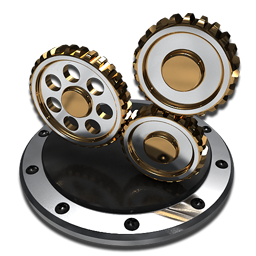
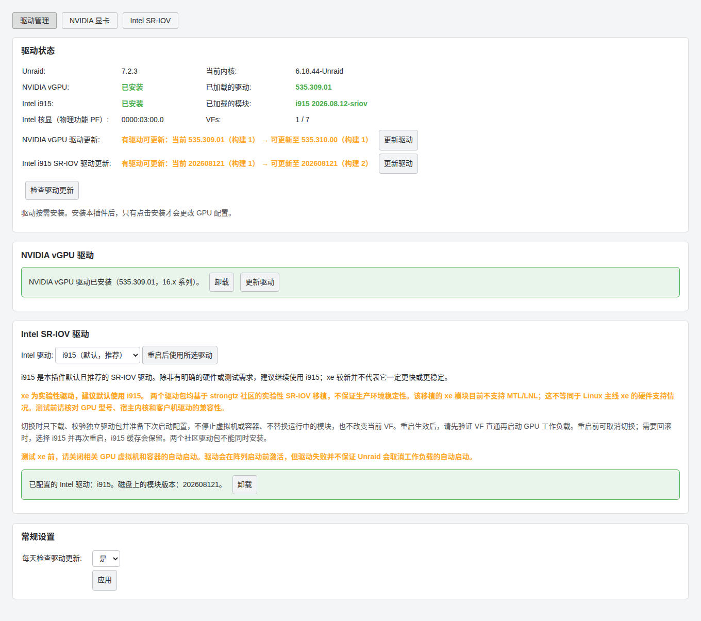

# my-unraid-vgpu-manager

在 Unraid 中管理 NVIDIA vGPU 与 Intel SR-IOV：下载匹配的驱动、分配虚拟 GPU 给虚拟机，并在重启后恢复。

[English](README.md) · [简体中文](README.zh-CN.md) · [使用指南](docs/guide.zh-CN.md)

[](https://github.com/hellomrli/my-unraid-vgpu-manager/actions/workflows/check.yml)
[](LICENSE)

## 安装插件

**[插件安装链接（.plg）](https://github.com/hellomrli/my-unraid-vgpu-manager/raw/master/my-unraid-vgpu-manager.plg)**

打开 Unraid 的 **插件（Plugins）→ 安装插件（Install Plugin）**，粘贴下面的地址。点击代码块右上角的**复制按钮**即可复制完整链接：

```text
https://github.com/hellomrli/my-unraid-vgpu-manager/raw/master/my-unraid-vgpu-manager.plg
```

需要 **Unraid 7.2.3 或更新版本**及兼容的 GPU。Unraid 会通过这个 `.plg` 下载对应的插件安装包，后续更新同样使用插件管理器；**无需插件 GitHub Release，也无需手动下载安装包。** 安装插件本身不会安装 GPU 驱动。

> [!IMPORTANT]
> **Intel SR-IOV 默认、推荐使用 i915；xe 是可选的实验性驱动，切换需要重启。** 升级插件不会自动将现有用户切换到 xe。

## 快速开始

打开 **设置 → Unraid vGPU 管理器**。安装驱动前，先卸载管理同一驱动的其他插件并重启；仅监控 GPU 的 intel-gpu-top 不属于冲突插件。

| 你的 GPU | 首次使用 |
|---|---|
| 支持 SR-IOV 的 Intel GPU | 在**驱动管理**中保留 **i915（推荐）**并安装，按照 Intel 页面的 IOMMU/启动提示操作，需要时重启。设置 VF 数量，再将 **VF** 直通给虚拟机，**不要直通 PF**。 |
| 支持 vGPU 的 NVIDIA GPU | 在**驱动管理**中选择支持的系列并安装。在 **NVIDIA 显卡**页配置授权、按配置档创建 vGPU 并绑定虚拟机，冷启动虚拟机后挂载设备。 |

完成后，页面会显示所选驱动与虚拟 GPU 设备；已启用的设备会在开机时从已校验的缓存包恢复。客户机仍需安装兼容的 GPU 驱动。



*截图来自隔离测试环境，用于展示界面，不代表真机兼容性认证。*

## 选择 i915 或 xe

| 驱动 | 选择建议 |
|---|---|
| **i915** | **默认、推荐。** 保持本项目已有的 Intel SR-IOV 使用路线；上游 xe 更新并不意味着需要切换当前正常工作的驱动。 |
| **xe** | **实验性，手动选择。** Intel 较新的驱动架构，以独立驱动包提供，适合进行兼容性验证与测试。 |

较新不等于在你的 Unraid SR-IOV 负载中更快、更稳定。两个包均来自 [strongtz 社区实验性移植](https://github.com/strongtz/i915-sriov-dkms)，并非 Intel 的生产环境支持承诺。该移植目前明确警告其 **xe 模块不支持 Meteor Lake 和 Lunar Lake**；这不代表主线 xe 的情况，也不保证这些平台都能使用 i915 SR-IOV。

在**驱动管理 → Intel SR-IOV 驱动**中切换：

1. 选择目标驱动并确认。插件下载、校验独立驱动包，保留回退缓存并准备下次启动配置；不会停止工作负载、替换运行中的包或改变当前 VF。
2. 测试 xe 前，关闭 GPU 虚拟机/容器的自动启动，再重启。驱动在阵列启动前从本地缓存激活；驱动失败**不保证** Unraid 会取消工作负载自动启动。
3. 核对实际加载的驱动和 VF 直通，再启动 GPU 工作负载。重启前可以取消切换；重启后测试失败，则选择 i915 并再次重启回退。

**不要手动同时安装两个 Intel 包**：它们共用兼容模块，必须互斥。启动参数冲突、多 GPU 限制和故障日志见[切换与恢复细节](docs/guide.zh-CN.md#选择-i915-或-xe)。

## 主要功能

- **独立管理 GPU 栈**：NVIDIA 与所选 Intel 驱动分别维护安装状态、更新检查及缓存。
- **按内核匹配驱动**：升级 Unraid 后，为实际写入 `/boot/bzimage` 的内核预下载已启用的驱动，不改动当前运行的驱动。
- **离线开机恢复**：从已校验的缓存包恢复启用的驱动和设备，不依赖开机时联网。
- **手动执行驱动更新**：定时检查只提示可用更新；明确执行更新可能停止相关 GPU 工作负载，之后需要手动启动。
- **NVIDIA 系列与 Intel CCS0**：按硬件选择 NVIDIA 系列，为支持的 Intel 模块提供独立 CCS0 偏好设置。

Intel 驱动仓库只跟进当前正式版、当前公开 beta/RC 使用的内核，以及 ich777 的最新备编内核，合并去重后维护。历史包保留，但退出这些来源的旧内核不再更新。[查看内核覆盖与 Intel 驱动说明](https://github.com/hellomrli/my-i915-sriov-driver#内核覆盖与更新)。

## 文档与反馈

| 需要什么 | 入口 |
|---|---|
| 配置、更新、卸载与恢复 | [使用指南](docs/guide.zh-CN.md) |
| NVIDIA 系列与硬件限制 | [硬件说明](docs/guide.zh-CN.md#驱动系列与硬件) |
| 修改或验证插件 | [开发与验证](docs/guide.zh-CN.md#开发与验证) |
| 反馈问题 | [Issues](https://github.com/hellomrli/my-unraid-vgpu-manager/issues)，请附 Unraid/内核版本、GPU 型号及相关日志，注意移除密钥等敏感信息 |
| 插件变更与安装包校验值 | [插件清单](my-unraid-vgpu-manager.plg) |
| 驱动来源 | [Intel](https://github.com/hellomrli/my-i915-sriov-driver) · [NVIDIA](https://github.com/hellomrli/my-nvidia-vgpu-driver) |

[GPL-3.0](LICENSE)。自动化测试覆盖打包、隔离的生命周期行为与中英文界面，不能替代你的 Unraid 真机验证。
